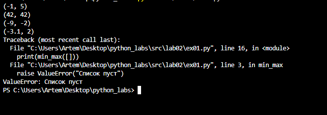
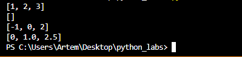
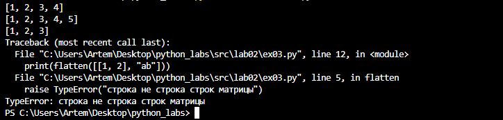
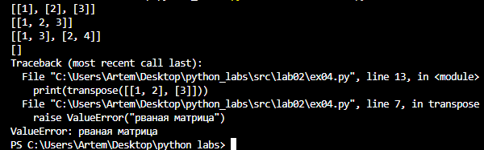
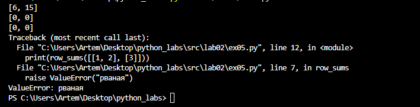
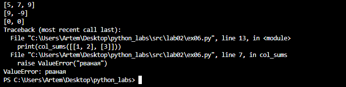
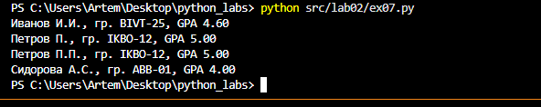

## ЛР2 — Коллекции и матрицы (list/tuple/set/dict)

### Задание 1
Эта функция находит минимальный и максимальный элементы списка.
```python
def min_max(nums):
    if len(nums) == 0:
        raise ValueError("Список пуст")
    minimum = nums[0]
    maximum = nums[0] 
    for num in nums:
        if num < minimum:
            minimum = num
        if num > maximum:
             maximum = num
    return (minimum, maximum)
print(min_max([3, -1, 5, 5, 0]))
print(min_max([42]))
print(min_max([-5, -2, -9]))
print(min_max([1.5, 2, 2.0, -3.1]))
print(min_max([]))
```


Эта функция возвращает отсортированный список уникальных значений (по возрастанию).
```python
def unique_sorted(nums):
    unique_nums = []
    for num in nums:
        if num not in unique_nums:
            unique_nums.append(num)
    n = len(unique_nums)
    for i in range(n):
        for j in range(0, n - i - 1):
            if unique_nums[j] > unique_nums[j + 1]:
                unique_nums[j], unique_nums[j + 1] = unique_nums[j + 1], unique_nums[j]
    return unique_nums
print(unique_sorted([3, 1, 2, 1, 3]))
print(unique_sorted([]))
print(unique_sorted([-1, -1, 0, 2, 2]))
print(unique_sorted([1.0, 1, 2.5, 2.5, 0]))
```
 

Эта функция «расплющивает» список списков/кортежей в один список по строкам.
```python
def flatten(mat):
    result = []
    for row in mat:
        if not isinstance(row, (list, tuple)):
            raise TypeError("строка не строка строк матрицы")
        for item in row:
            result.append(item)
    return result
print(flatten([[1, 2], [3, 4]]))
print(flatten([[1, 2], (3, 4, 5)]))
print(flatten([[1], [], [2, 3]]))
print(flatten([[1, 2], "ab"]))
```
 
### Задание 2
Эта функция меняет строки и столбцы местами.
```python
def transpose(mat):
    if not mat:
        return []
    row_len = len(mat[0])
    for row in mat:
        if len(row) != row_len:
            raise ValueError("рваная матрица")
    return [list(row) for row in zip(*mat)]
print(transpose([[1, 2, 3]]))
print(transpose([[1], [2], [3]]))
print(transpose([[1, 2], [3, 4]]))
print(transpose([]))
print(transpose([[1, 2], [3]]))
```
 

Эта функция считает сумму по каждой строке.
```python
def row_sums(mat):
    if not mat:
        return []
    row_len = len(mat[0])
    for row in mat:
        if len(row) != row_len:
            raise ValueError("рваная")
    return [sum(row) for row in mat]
print(row_sums([[1, 2, 3], [4, 5, 6]]))
print(row_sums([[-1, 1], [10, -10]]))
print(row_sums([[0, 0], [0, 0]]))
print(row_sums([[1, 2], [3]]))
```
 

Эта функция считает сумму по каждому столбцу.
```python
def col_sums(mat):
    if not mat:
        return []
    row_len = len(mat[0])
    for row in mat:
        if len(row) != row_len:
            raise ValueError("рваная")
    transposed = [list(row) for row in zip(*mat)]
    return [sum(row) for row in transposed]
print(col_sums([[1, 2, 3], [4, 5, 6]]))
print(col_sums([[-1, 1], [10, -10]]))
print(col_sums([[0, 0], [0, 0]]))
print(col_sums([[1, 2], [3]]))
```
 
### Задание 3
Функция обрабатывает данные вида: «Фамилия Имя Отчество, группа, GPA».
```python
def format_record(rec):
    if len(rec)==3:
        fio,group,gpa = rec
    else:
        raise ValueError("Неверно введены данные")
    if not isinstance(rec,tuple):
        raise TypeError("На входе должен быть кортеж")
    if len(fio.strip())==0:
        raise ValueError("Пустое имя")
    if not isinstance(fio, str):
        raise TypeError("Неверный тип ФИО")
    if len(group)==0:
        raise ValueError("Пустая группа")
    if not isinstance(group, str):
        raise TypeError("Неверный тип группы")
    if not gpa:
        raise ValueError("Пустой GPA")
    if not isinstance(gpa, float):
        raise TypeError("Неверный тип GPA")
    if not 0.0<=gpa<=5.0:
        raise ValueError("Неправильное значение: должно быть 0.0<=GPA<=5.0")
    fio_new=""
    fio=fio.split()
    if len(fio)<2 or len(fio)>3:
        raise ValueError("ФИО должно содержать 2-3 слова")
    if len(fio)==2:
        fio_new=fio[0][:1].upper() + fio[0][1:] + " " + fio[1][0].upper() + "."
    if len(fio)==3:
        fio_new=fio[0][:1].upper() + fio[0][1:] + " " + fio[1][0].upper() + "." + fio[2][0].upper() + "."
    return f"{fio_new}, гр. {group.strip()}, GPA {gpa:.2f}"
if __name__=="__main__":
    print(format_record(("Иванов Иван Иванович", "BIVT-25", 4.6)))
    print(format_record(("Петров Пётр", "IKBO-12", 5.0)))
    print(format_record(("Петров Пётр Петрович", "IKBO-12", 5.0)))
    print(format_record(("  сидорова  анна   сергеевна ", "ABB-01", 3.999)))
```
