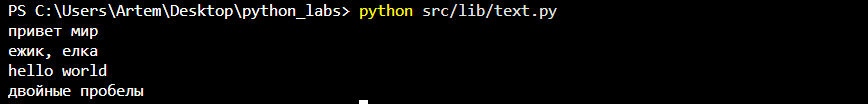
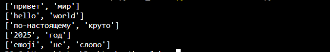
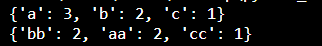
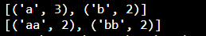
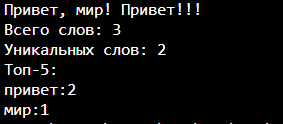

## ЛР2 — Коллекции и матрицы (list/tuple/set/dict)

### Задание A — src/lib/text.py

### normalize

Нормализация. Преобразование строки s в norm(s):

1.Заменяет все ё/Ё на е/Е
2.Заменяет управляющие символы \t, \r, \n на пробел
3.«Схлопывает» последовательности пробелов в один
```python
def normalize(text: str, *, casefold: bool = True, yo2e: bool = True) -> str:

    '''
    Нормализация. Преобразование строки s в norm(s):
    1) Нормализует
    2) Заменяет все ё/Ё на е/Е
    3) Заменяет управляющие символы \\t, \\r, \\n на пробел
    4) «Схлопывает» последовательности пробелов в один
    '''

    text = text.replace("\t"," ")
    text = text.replace("\n"," ")
    text = text.replace("\r"," ")

    if yo2e:
        text = text.replace("ё","е")
        text = text.replace("Ё","Е")

    if casefold:
        text = text.casefold()

    text = " ".join(text.split())
        
    return text.strip()
```

### tokenize

Токенизация. Множество слов — это все подстроки, удовлетворяющие шаблону: \w+(?:-\w+)* (буквы/цифры/подчёркивание; допускается дефис внутри слова), разделённые любыми не-\w символами.
```python
def tokenize(text: str) -> list[str]:

    '''
    Токенизация. Множество слов — это все подстроки, удовлетворяющие шаблону \\w+(?:-\\w+)*
    (буквы/цифры/подчёркивание; допускается дефис внутри слова), разделённые любыми не-\\w символами.
    '''

    tokens = re.findall(r"\w+(?:-\w+)*",text)
    return tokens
```

### count_freq

Частоты. Для списка токенов T = [t₁, …, tₙ] частота слова w равна: f(w) = |{ i : tᵢ = w }|.
```python
def count_freq(tokens: list[str]) -> dict[str, int]:

    '''
    Частоты. Для списка токенов T = [t₁, …, tₙ] частота слова w равна
    f(w) = |{ i : tᵢ = w }|.
    '''

    freq = {}

    for i in tokens:
        if i in freq:
            freq[i] += 1
        else:
            freq[i] = 1
            
    return freq
```

### top_n

Топ-N. Отсортировать пары (слово, частота) по ключу (-частота, слово) и взять первые N.
```python
def top_n(freq: dict[str, int], n: int = 5) -> list[tuple[str, int]]:

    '''
    Топ-N. Отсортировать пары (слово, частота) по ключу (-частота, слово) и взять первые N.
    '''

    ans_freq = sorted(freq.items(), key=lambda x: (-x[1],x[0]))
    return ans_freq[:n]
```

### Задание B — src/text_stats.py (скрипт со stdin)

Скрипт читает текст из stdin, нормализует и токенизирует его с помощью функций из модуля text.py, считает общее количество слов, количество уникальных слов и выводит топ-5 самых частых слов. Добавлена возможность вывода красивой таблички(переменная tablet).
```python
from src.lib.text import normalize, tokenize, count_freq, top_n
text=input()

normal_text=normalize(text)
token_text=tokenize(normal_text)
freq_text=count_freq(token_text)
top_text=top_n(freq_text)

print(f"Всего слов: {len(token_text)}")
print(f"Уникальных слов: {len(freq_text)}")
print(f"Топ-5:")
for x in range(len(top_text)):
    print(f"{top_text[x][0]}:{top_text[x][1]}")
```

### Как запустить

Написать
```python
python -m src.lab03.text_stats
```