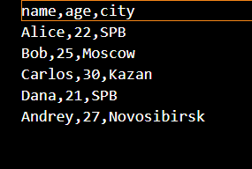
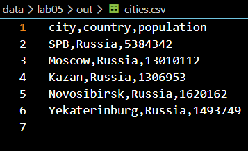
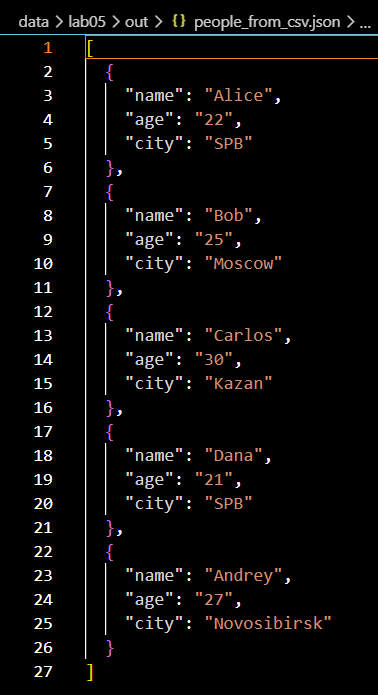
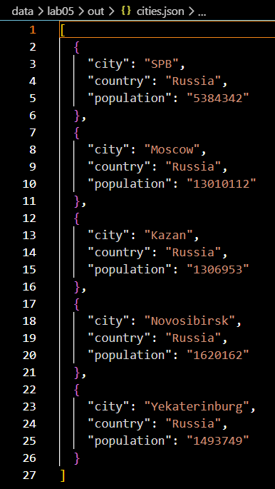
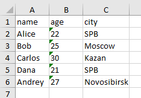
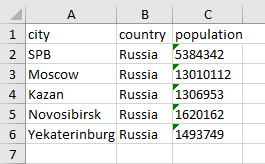

## ЛР5 - JSON и конвертации (JSON↔CSV, CSV→XLSX)

### Структура лабораторной работы
src/lab05/json_csv.py — преобразование JSON в CSV и CSV в JSON;                             
src/lab05/csv_xlsx.py — преобразование CSV в XLSX.                                               
Входные примеры находятся в каталоге data/lab05/samples/, а результаты конвертаций — в каталоге data/lab05/out/.

### Задание A — JSON ↔ CSV
Функция json_to_csv
```python
from pathlib import Path
import json
import csv
from src.lab04.io_txt_csv import ensure_parent_dir

def json_to_csv(json_path: str, csv_path: str) -> None:
    """
    Преобразует JSON-файл в CSV.
    Поддерживает список словарей [{...}, {...}], заполняет отсутствующие поля пустыми строками.
    Кодировка UTF-8. Порядок колонок — как в первом объекте.
    """
    json_file = Path(json_path)
    csv_file = Path(csv_path)

    if not json_file.exists():
        raise FileNotFoundError("Файл не найден")
    
    if json_file.suffix.lower() != ".json":
        raise ValueError(f"Неверный формат входного файла: ожидается .json")
    
    if csv_file.suffix.lower() != ".csv":
        raise ValueError(f"Неверный формат выходного файла: ожидается .csv")

    with json_file.open('r', encoding='utf-8') as p:
        try:
            data = json.load(p)
        except json.JSONDecodeError:
            raise ValueError("Пустой JSON или неподдерживаемая структура")

    if not isinstance(data, list) or len(data) == 0:
        raise ValueError('Файл JSON пустой или имеет неправильный формат')
    if not all(isinstance(item, dict) for item in data):
        raise ValueError("Все элементы списка JSON должны быть словарями")

    ensure_parent_dir(csv_file)

    fieldnames = {}
    for element in data:
        for key in element.keys():
            fieldnames[key] = None

    with csv_file.open('w', newline="", encoding='utf-8') as f:
        w = csv.DictWriter(f, fieldnames=list(fieldnames.keys()))
        w.writeheader()
        w.writerows(data)
```
Функция:

1) Проверяет существование входного файла;
2) Проверяет расширение .json и .csv;
3) Читает JSON в кодировке UTF-8;
4) Проверяет, что корневой объект является непустым списком словарей;
5) Собирает названия всех ключей в порядке их первого появления;
6) Записывает заголовок и строки в CSV в кодировке UTF-8.
7) Если в одном из словарей отсутствует ключ, csv.DictWriter записывает в соответствующую ячейку пустое значение.

Пример вызова:
```python
json_to_csv(
    "data/lab05/samples/people.json",
    "data/lab05/out/people_from_json.csv",
)
```
 
                            

Функция csv_to_json
```python
from pathlib import Path
import json
import csv
from src.lab04.io_txt_csv import ensure_parent_dir

def csv_to_json(csv_path: str, json_path: str) -> None:
    """
    Преобразует CSV в JSON (список словарей).
    Заголовок обязателен, значения сохраняются как строки.
    json.dump(..., ensure_ascii=False, indent=2)
    """
    json_file = Path(json_path)
    csv_file = Path(csv_path)

    if not csv_file.exists():
        raise FileNotFoundError("Файл не найден")
    
    if json_file.suffix.lower() != ".json":
        raise ValueError(f"Неверный формат входного файла: ожидается .json")
    
    if csv_file.suffix.lower() != ".csv":
        raise ValueError(f"Неверный формат выходного файла: ожидается .csv")

    
    with csv_file.open("r", newline="", encoding="utf-8") as f:
        reader = csv.DictReader(f)
        if reader.fieldnames is None:
            raise ValueError("CSV не содержит заголовок")
        
        data = list(reader)

    if not data:
        raise ValueError("Файл CSV не содержит данных")

    ensure_parent_dir(json_file)

    with json_file.open("w", encoding="utf-8") as f:
        json.dump(data, f, ensure_ascii=False, indent=2)
```
Функция:

1) Проверяет существование входного файла;
2) Проверяет расширение .csv и .json;
3) Читает CSV в кодировке UTF-8;
4) Проверяет наличие заголовка и хотя бы одной строки данных;
5) Преобразует каждую строку в словарь;
6) Сохраняет список словарей в JSON с отступом в два пробела.
Пример вызова:
```python
csv_to_json(
    "data/lab05/samples/people.csv",
    "data/lab05/out/people_from_csv.json",
)
```
 
                             

Запуск модуля JSON ↔ CSV                              
Из корня репозитория:
```python
powershell
python -m src.lab05.json_csv
```
При таком запуске создаются:

data/lab05/out/people_from_csv.json;                                                                     
data/lab05/out/people_from_json.csv;                                                                      
data/lab05/out/cities.json;                                                                             
data/lab05/out/cities.csv.                                     
### Задание B — CSV → XLSX
```python
import csv
from pathlib import Path
from openpyxl import Workbook
from openpyxl.utils import get_column_letter
from src.lab04.io_txt_csv import ensure_parent_dir

def csv_to_xlsx(csv_path: str, xlsx_path: str) -> None:
    """
    Конвертирует CSV в XLSX.
    Использует openpyxl.
    Первая строка CSV — заголовок.
    Лист называется "Sheet1".
    Колонки — автоширина по длине текста (не менее 8 символов).
    """
    src = Path(csv_path)
    dst = Path(xlsx_path)

    if not src.exists():
        raise FileNotFoundError("Указанный CSV файл не найден")
    if src.suffix.lower() != ".csv":
        raise ValueError(f"Неверный тип файла: ожидается .csv, получено '{src.suffix}'")
    if dst.suffix.lower() != ".xlsx":
        raise ValueError(f"Неверный тип файла: ожидается .xlsx, получено '{dst.suffix}'")

    with src.open('r', newline='', encoding='utf-8') as f:
        reader = list(csv.reader(f))

    if not reader:
        raise ValueError("Файл CSV пустой")

    widths = {}
    for row in reader:
        for index, cell in enumerate(row):
            if len(cell) > widths.get(index, 0):
                widths[index] = len(cell)

    wb = Workbook()
    ws = wb.active
    ws.title = "Sheet1"
    for row in reader:
        ws.append(row)

    for index, width in widths.items():
        letter = get_column_letter(index + 1)
        ws.column_dimensions[letter].width = max(8, width)

    ensure_parent_dir(dst)
    wb.save(dst)
```
Функция:

1) Проверяет существование CSV-файла;
2) Проверяет расширение .csv и .xlsx;
3) Читает строки в кодировке UTF-8;
4) Создаёт книгу Excel с помощью openpyxl;
5) Добавляет строки CSV на лист Sheet1;
6) Рассчитывает ширину столбцов;
7) Сохраняет результат по указанному пути.
Пример вызова:
```python
csv_to_xlsx(
    "data/lab05/samples/people.csv",
    "data/lab05/out/people.xlsx",
)
```
 
                                                            

Запуск модуля CSV → XLSX
```python
python -m src.lab05.csv_xlsx
```
После запуска создаётся файл data/lab05/out/people.xlsx , data/lab05/out/cities.xlsx.

### Обработка ошибок
Входные функции явно сообщают об ошибках:

FileNotFoundError — входной файл не найден;                                      
ValueError — расширение файла не соответствует ожидаемому формату;                                          
ValueError — JSON пустой, имеет неподдерживаемую структуру или содержит элементы не-словари;                                         
ValueError — CSV пустой или не содержит строк данных.                                                   

Родительский каталог выходного файла создаётся функцией ensure_parent_dir() из src.lab04.io_txt_csv, поэтому выходные каталоги должны создаваться автоматически.